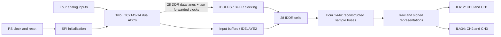

# Red Pitaya 4-Channel ADC DDR Capture and ILA Validation

**Hardware-derived FPGA validation study | 14-bit, 125 MS/s, four analog input channels | Vivado 2025.2**

This repository documents an **experimentally tested** ADC acquisition path on the Red Pitaya STEMlab 125-14 **4-Input** (Zynq XC7Z020), including a reproducible analysis of actual Vivado Integrated Logic Analyzer (ILA) captures. It explains a DDR serialization/word-reconstruction defect found with a 5 MHz input and the tested correction.

> **Source-integrity policy.** The evidence CSVs and analysis plots in this package come from real captures. The Vivado source files and bitstreams must be exported **unchanged from the project on the Windows PC** using `scripts/collect_from_windows.ps1`. No missing RTL, IP, XDC, board pin assignment, or packaged IP has been invented. The Windows source export has now completed successfully: 32 files are SHA-256 verified, including the corrected IDDR RTL and FPGA release artifacts. An independent clean Vivado rebuild remains unverified.

## Result: corrected capture closely matches a 5 MHz sine


| Metric | Before fix: ILA CH1 | After fix: ILA CH0 |
|---|---:|---:|
| Samples per capture | 4,096 | 4,096 |
| Nominal generator setting | 5 MHz sine | 5 MHz sine |
| Fitted frequency* | 5.000182 MHz | **5.000064 MHz** |
| Single-tone sine-fit R² | **0.152454** | **0.999991** |
| RMS deviation from fitted sine | 3459.8 codes | **9.50 codes** |
| Counter increments | Continuous | Continuous |
| Observed `status12_sync` | `0xF` | `0xF` |

*Frequency estimates assume an ILA sample rate of 125 MHz (to be independently confirmed in the clock configuration). These data are **two different captures on two different reported channels**: the input cable location and physical channel mapping were not independently logged. They strongly support the correction but are **not** a calibrated ENOB/SINAD/THD measurement or a fully controlled same-channel A/B comparison.

### Finding and correction

The experimental ADC acquisition RTL used 28 DDR input lanes (4 channels × 7 lanes; two ADC bits per lane). The observed original capture showed periodic 5 MHz content but corrupted numeric words. The tested changes to `adc_ddr_unpack.sv` were:

```systemverilog
// Original captured RTL (before)
.DDR_CLK_EDGE("SAME_EDGE"),
.Q1(adc_raw[ch][2*bit_idx+1]),
.Q2(adc_raw[ch][2*bit_idx]),

// Corrected RTL (from the user's local Vivado source inspection)
.DDR_CLK_EDGE("SAME_EDGE_PIPELINED"),
.Q1(adc_raw[ch][2*bit_idx]),
.Q2(adc_raw[ch][2*bit_idx+1]),
```

The interpretation is **correct phase-to-bit assignment plus cycle alignment**. To inspect the complete real module and its provenance, see the files exported from Vivado. The extra register-stage latency in `SAME_EDGE_PIPELINED` must be considered by downstream integration.

## Architecture



The diagram is a conceptual representation of the **observed design hierarchy**, not an exported Vivado schematic. See [architecture](docs/ARCHITECTURE.md) for clock and reset details.

## Repository contents

| Path | What it contains | Origin |
|---|---|---|
| `evidence/data/` | Original and corrected ILA capture CSVs | Real exported FPGA captures |
| `evidence/plots/` | Capture comparison and submitted hardware screenshots | Generated from real data / user screenshots |
| `evidence/results/` | Machine-readable measured metrics | Deterministic analysis script |
| `scripts/analyze_capture.py` | Sine fit, FFT-bin check, counter and sample validation | Analysis code |
| `tests/` | Automated assertions on actual capture evidence | Reproducibility checks |
| `fpga/source_snapshot/` | Original Vivado `.srcs`, `.xpr` files **after local export** | **Real local project; no generated substitutes** |
| `fpga/external_constraints/` | Actual project-external trial XDC **after local export** | Real local files |
| `fpga/releases/` | Actual `.bit` / `.ltx` **after local export** | Real compiled implementation |
| `evidence/reports/` | Real Vivado timing/DRC/run logs **after local export** | Real local files |
| `fpga/provenance_manifest.csv` | SHA-256 and relative origin of all exported files | Generated on PC by exporter |

## Verify the evidence immediately

Requires Python 3.10+ and the dependencies in `requirements.txt`.

```bash
python -m pip install -r requirements.txt
python scripts/analyze_capture.py --old evidence/data/original_5mhz_ch01.csv --new evidence/data/corrected_5mhz_ch01.csv --output evidence/results
python -m unittest discover -s tests -v
python scripts/verify_export.py
```

The final command checks the **actual files exported from the PC** if the manifest is present. For a complete GitHub release, it should report `SOURCE_EXPORT: VERIFIED`.

## Export the exact, working Vivado files from the Windows PC

Download/unzip this kit, then in **Windows PowerShell** from its repository folder:

```powershell
powershell -ExecutionPolicy Bypass -File .\scripts\collect_from_windows.ps1
```

The exporter checks `D:\rp-adc-ila-puzzle-trial\adc_clock_sandbox\` by default, requires the corrected IDDR declarations, checks the two trial XDCs and bitstream pair, copies the source/project snapshot without modifying it, and writes a SHA-256 manifest. It stops on missing or changed critical inputs. You can specify a different project root with `-ProjectRoot` if needed.

Then run:

```powershell
python .\scripts\verify_export.py --require-source
python -m unittest discover -s tests -v
```

**Important:** The copied `.xpr` can contain absolute file references from the original machine, and AMD IP may need regeneration. For a transportable recreation script, open the original Vivado project and use `write_project_tcl` as explained in [reproduction](docs/REPRODUCE.md). A clean build on a second machine has **not** been demonstrated. Do not imply that an existing routed timing result proves portability.

## What was hardware-tested?

- HS3 JTAG programming of Zynq `xc7z020_1`: successful; FPGA startup HIGH.
- Two ILA cores recognized: `hw_ila_1` CH0/CH1 and `hw_ila_2` CH2/CH3.
- Corrected bitstream from `impl_adc_fix_200`: generated and JTAG programmed.
- Corrected ILA capture: 4096 samples on CH0/CH1 with a visible 5 MHz sinusoidal signal and high-quality sine fit on CH0.
- Reported routed timing, using **experimental** ADC input timing model: WNS **+1.139 ns**, WHS **+0.035 ns**; bus-skew checks passed on reported debug-hub FIFO paths.

Not yet independently established: complete four-channel analog test; channel-to-SMA mapping; physical PCB skew timing sign-off; calibration-quality distortion characterization; clean rebuild from another PC; packaged reusable Vivado IP; VDIF/DMA streaming integration. See [validation](docs/VALIDATION.md) and [timing/CDC caution](docs/TIMING_AND_CDC.md).

## References

- [Red Pitaya STEMlab 125-14 4-Input hardware documentation](https://redpitaya.readthedocs.io/en/latest/developerGuide/hardware/ORIG_GEN/125-14_4IN/top.html)
- [Analog Devices LTC2145-14 product and datasheet](https://www.analog.com/en/products/ltc2145-14.html)
- [AMD Vivado project archiving guidance (UG895)](https://docs.amd.com/r/2025.1-English/ug895-vivado-system-level-design-entry/Archiving-Projects)

## Sharing and scope

This is a controlled **validation sandbox**; it is not a full production receiver, DMA, VDIF, or Ethernet transmission system. Review third-party licenses, board pin-out constraints, and source/project metadata before making the repository public. A private GitHub repository shared with the supervisor is recommended until disclosure is approved.

### Pre-publication checks

After export, run `python scripts/audit_for_sharing.py` and review its findings manually. For a guided **new private** GitHub repo creation from Windows, see `scripts/publish_private.ps1`; it requires Git, GitHub CLI authentication, and an explicit confirmation before pushing.
