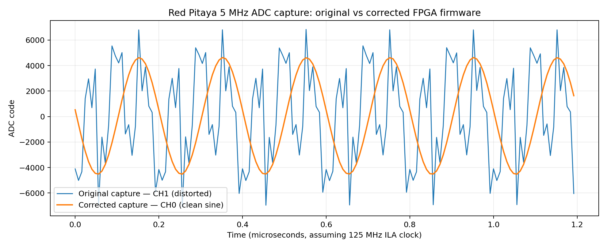
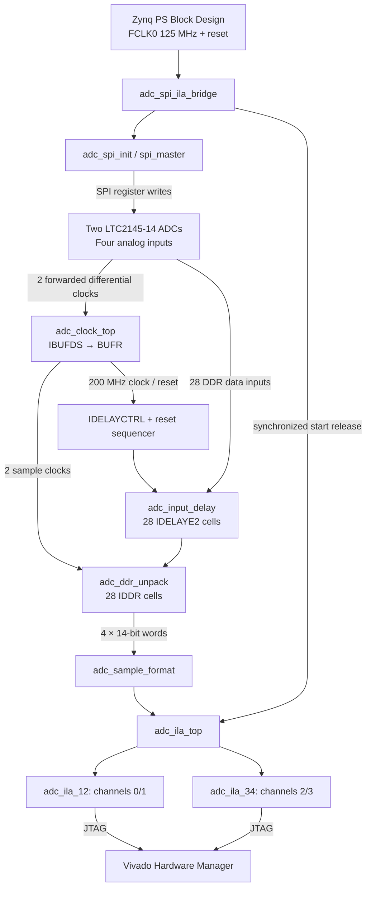

# Red Pitaya 4-Channel ADC — Complete FPGA Architecture & Reproducible Validation

> **Experimental variant added — 12 November 2026:** In addition to the original two-ILA source snapshot and release, this repository includes a separately selectable **single-ILA four-channel two's-complement overlay** with an experimental **8-ADC0-clock CH0/CH1 register delay**. It was synthesized, routed and tested over HS3 JTAG on the Red Pitaya 4-input board. At 1 MHz, CH2/CH3's apparent lag versus CH0 moved from +7.767/+7.744 samples to -0.274/-0.253 samples after compensation. This is **observed sinusoidal phase alignment**, not proven simultaneous ADC sampling or absolute FIFO latency. See the **[alignment hardware report](docs/SINGLE_ILA_8CYCLE_ALIGNMENT_20261112.md)**, [sample extrema CSV](evidence/analysis/adc_1mhz_before_after_min_max_summary.csv), and [analysis script](scripts/analyze_single_ila_alignment.py). **The original release artifacts and default exported RTL snapshot have not been replaced.** CDC, ADC I/O timing and long-term FIFO stability remain open before production deployment.

**Technical documentation, RTL architecture, reproducibility and experimental validation.**  
**Test platform:** Red Pitaya STEMlab **125-14 4-Input** · Zynq **XC7Z020CLG400-1** · two LTC2145-14 dual-channel ADCs · **14 bits/channel** · nominal **125 MS/s/channel** · AMD Vivado **2025.2**.

> **Baseline two-ILA source/release (sections below):** Working corrected FPGA bitstream programmed over HS3 JTAG; two ILA cores detected; a 4,096-sample 5 MHz capture gives sine-fit R² ≈ **0.999991** on the observed channel. A **separate clean local Git clone** was also successfully synthesized, implemented and compiled into a new bitstream using Vivado 2025.2.
>
> **Newly verified (12 November 2026):** All four logical ADC channels produced 5 MHz-consistent sinusoidal data in two separate, 4,096-sample Vivado ILA captures. Both sample counters incremented continuously, ready/status flags stayed `0xF`, and the exact 14-bit raw-to-signed RTL mapping was confirmed. [Measured results and provenance](docs/FOUR_CHANNEL_VALIDATION_20261112.md).
>
> **Not yet proven for the baseline release:** Controlled physical connector-to-logical channel mapping, simultaneous four-channel acquisition, calibrated ADC performance, final PCB/ADC timing sign-off, a second-computer rebuild, or a hardware retest conclusively attributed to the separately rebuilt bitstream.
>
> **Self-contained design:** No PuzzleFW download, earlier firmware project, original PC folders or external project Tcl is needed. The actual RTL, IP configurations, Block Design, constraints, tested build Tcl, two recorded bitstream/probe pairs, CSVs and reports are in this repository. Building/programming still requires Vivado and suitable physical hardware.



## Documentation index

1. [Goal and basic concepts](#1-goal-and-basic-concepts)
2. [Hardware: what connects to what](#2-hardware-what-connects-to-what)
3. [Full architecture](#3-full-architecture)
4. [The actual module hierarchy](#4-the-actual-module-hierarchy)
5. [How the board starts: PS, SPI and reset](#5-how-the-board-starts-ps-spi-and-reset)
6. [Clock architecture and why we consulted PuzzleFW](#6-clock-architecture-and-why-we-consulted-puzzlefw)
7. [Input delay and DDR reconstruction](#7-input-delay-and-ddr-reconstruction)
8. [Sample formatting and ILA debugging](#8-sample-formatting-and-ila-debugging)
9. [What was broken and what fixed it](#9-what-was-broken-and-what-fixed-it)
10. [Timing constraints and CDC](#10-timing-constraints-and-cdc)
11. [Evidence and measured results](#11-evidence-and-measured-results)
12. [Clone, test and rebuild a bitstream](#12-clone-test-and-rebuild-a-bitstream)
13. [Program hardware and capture samples](#13-program-hardware-and-capture-samples)
14. [Repository files and portability](#14-repository-files-and-portability)
15. [Troubleshooting](#15-troubleshooting)
16. [What is verified and what remains](#16-what-is-verified-and-what-remains)
17. [Step-by-step learning order and glossary](#17-step-by-step-learning-order-and-glossary)
18. [Licenses and optional references](#18-licenses-and-optional-references)

---

## 1. Objectives and system fundamentals

**Problem:** Four ADC channels are each nominally sampled 125 million times per second with 14-bit precision. Their chips send the samples to the FPGA through only **seven data wires per channel**, with **one bit per wire on each clock edge**. The FPGA must recover the correct 14-bit word from rising/falling edge data, without mixing bit order or sample cycles.

**Objective:** Configure the ADCs, make a safe source-synchronous sampling path, reconstruct digital samples, and prove the output from actual Vivado Integrated Logic Analyzer (ILA) captures.

| Beginner term | Meaning in this project |
|---|---|
| **Analog input** | Continuous input voltage at one of four SMA connectors |
| **ADC** | Analog-to-digital converter producing digital sample codes |
| **PS** | Zynq Processing System (ARM hardware): supplies initialization clock/reset here |
| **PL / FPGA** | Programmable Logic: performs SPI control, delays, DDR capture, counters and ILA |
| **RTL** | Verilog/SystemVerilog code describing the actual hardware connections |
| **DDR (data capture)** | One wire is sampled on both rising and falling clock edges; **not** PS DDR RAM |
| **IDDR** | FPGA primitive that outputs the two edge-captured bits as Q1 and Q2 |
| **ILA** | Internal Logic Analyzer, a digital oscilloscope inside the FPGA |
| **Bitstream (.bit)** | Binary program configuring the FPGA |
| **Probe file (.ltx)** | Matching mapping of implemented ILA signals for Hardware Manager |

**Scope boundary:** This project does **not** implement AXI DMA capture to RAM, VDIF, UDP, DAC playback, a PS/Linux sample-reading driver or an end-user oscilloscope application. The samples are examined **through the FPGA ILA and JTAG**.

## 2. Hardware: what connects to what

**Actual platform:** Red Pitaya STEMlab **125-14 4-Input**, two dual-channel **LTC2145-14** converters, Zynq `xc7z020clg400-1`. Four analog inputs feed four ADC sample streams. Each logical channel uses **7 DDR lanes**, so there are **28 physical data inputs**; two differential clocks serve the channel pairs **0/1** and **2/3**. Both forwarded clock periods are nominally **8 ns = 125 MHz**.

### Actual candidate FPGA pin assignments in the repository

Source: `fpga/source_snapshot/adc_clock_sandbox.srcs/constrs_1/imports/constraints/adc_4ch_complete_candidate.xdc`.

| RTL input | Lane 0 | Lane 1 | Lane 2 | Lane 3 | Lane 4 | Lane 5 | Lane 6 |
|---|---|---|---|---|---|---|---|
| `adc_data_pins[0]` | Y17 | Y16 | W14 | Y14 | V12 | W13 | V13 |
| `adc_data_pins[1]` | W15 | W16 | V15 | V16 | Y19 | W18 | Y18 |
| `adc_data_pins[2]` | W20 | W19 | V17 | V18 | U17 | T16 | T17 |
| `adc_data_pins[3]` | R19 | R17 | T15 | R16 | T20 | U20 | V20 |

Clock pin pairs: `adc_clk0_p/n` = **U18/U19** and `adc_clk1_p/n` = **N20/P20**. SPI CS-A = **P15**, CS-B = **P16**, SCLK = **P18**, MOSI = **N17**. Candidate XDC IO standards: `LVCMOS18` for ADC data/SPI, `DIFF_HSTL_I_18` for ADC clocks.

**Safety:** This is a **candidate** XDC validated in the exercised setup, not a universal board pinout. Check your Red Pitaya *4-Input* board revision, voltage levels and JTAG header before programming. Set the analog signal generator **OFF** during programming, and verify the board's LV/HV attenuation and safe input range before driving SMA inputs. The original captures did **not** record generator amplitude, physical SMA connector or offset; no safe voltage can be inferred from their CSV files.

## 3. Full architecture



**Key distinction:** PS appears because the top-level includes a Zynq PS startup Block Design and hard DDR/MIO interfaces. The **ADC samples do not travel into PS DDR RAM** in this validation firmware. The ILA observes PL signals directly and is downloaded through JTAG.

## 4. The actual module hierarchy

```text
adc_system_top
├─ u_ps: adc_ps_startup_wrapper   (generated from adc_ps_startup.bd)
└─ u_adc_bridge: adc_spi_ila_bridge
   ├─ u_spi_init: adc_spi_init
   │  └─ u_spi_master: spi_master
   └─ u_adc_ila: adc_ila_top
      ├─ u_frontend: adc_frontend_top
      │  ├─ u_adc_clocks: adc_clock_top
      │  │  ├─ IBUFDS + BUFR: sampling clocks
      │  │  ├─ Clock Wizard IP: 200 MHz reference / lock monitoring
      │  │  └─ u_idelay_reset: adc_idelay_reset_seq
      │  └─ u_adc_capture: adc_capture_core
      │     ├─ u_delay: adc_input_delay (IDELAYCTRL + 28 IDELAYE2)
      │     ├─ u_ddr: adc_ddr_unpack (28 IDDR)
      │     └─ u_format: adc_sample_format
      ├─ u_ila_12: adc_ila_12
      └─ u_ila_34: adc_ila_34
```

These are **actual names in checked-in RTL**, not a diagram inferred from a different Red Pitaya firmware.

| File under `fpga/source_snapshot/.../sources_1/imports/rtl/` | What it does |
|---|---|
| `adc_system_top.sv` | FPGA top-level physical PS/ADC/SPI ports; instantiates PS and bridge |
| `adc_spi_ila_bridge.sv` | SPI startup + three-stage synchronized acquisition reset release |
| `adc_spi_init.sv` | 100 ms nominal power-up delay and four SPI writes, completion signal |
| `spi_master.v` | Actual serial bit transmission on CS/SCLK/MOSI |
| `adc_ila_top.sv` | ADC frontend, status synchronization, counters and two ILAs |
| `adc_frontend_top.sv` | Connects clock/reset and ADC capture blocks |
| `adc_clock_top.sv` | Actual IBUFDS→BUFR capture clocks and Clock Wizard references |
| `adc_idelay_reset_seq.sv` | Delay-controller reset and ready sequencing |
| `adc_capture_core.sv` | Combines input delay, DDR word recovery and sample formatting |
| `adc_input_delay.sv` | 28 × IDELAYE2 and one IDELAYCTRL |
| `adc_ddr_unpack.sv` | Reconstructs four fourteen-bit raw samples using 28 IDDRs |
| `adc_sample_format.sv` | Converts raw words into the design's signed representation |

The Zynq PS wrapper is **not manually included** as a made-up HDL file: during a clean build, Vivado regenerates it from the checked-in `adc_ps_startup.bd` via `make_wrapper`. Separate IP configuration files describe the two clock wizards and two ILA cores.

## 5. How the board starts: PS, SPI and reset

**Why SPI?** Before data capture, the ADC must be configured into the interface/clocking mode expected by our RTL. SPI is a **control interface**, not the high-speed sample transport.

### Exact boot order

1. `adc_ps_startup_wrapper` supplies `ps_fclk_125` and active-low `ps_resetn` to `adc_spi_ila_bridge`.
2. `adc_spi_init` starts in `ST_DELAY`. The default `STARTUP_CYCLES = 12,500,000` equals **100 ms** at 125 MHz.
3. Its finite-state machine progresses through **`ST_START → ST_WAIT_BUSY → ST_WAIT_IDLE`** for each transaction and then `ST_DONE`.
4. The RTL writes the following **exact** register-address/data pairs:

   | Order | Address | Data |
   |---|---|---|
   | 1 | `0x0001` | `0x0000` |
   | 2 | `0x0002` | `0x000D` |
   | 3 | `0x0003` | `0x0002` |
   | 4 | `0x0004` | `0x0000` |

   The earlier design investigation associated these settings with output-clock phase/stabilization, DDR CMOS mode and data coding. For changing them, consult the **actual LTC2145-14 register descriptions** rather than assuming another ADC's encoding.

5. `spi_master` gets **8 address bits + 8 data bits**, `cfg_clk_presc_i = 10`, active-CS configuration, and outputs SPI SCLK/MOSI. MISO is tied low because this initializer uses **writes only**.
6. **Both** physical SPI chip-select pins (`spi_csa_o` and `spi_csb_o`) are assigned **the same** `spi_cs[0]` in the checked-in RTL, so both ADC chips receive the initialization sequence together.
7. `spi_done_o` goes high when all four writes finish. `adc_spi_ila_bridge` shifts three ones through `reset_release_sync` before releasing `adc_startup_resetn`.
8. Local sampling-clock resets and IDELAY calibration then settle; ILA observes samples and status.

**Important:** SPI itself never feeds the 5 MHz sample data into the FPGA. The high-speed data travels on the **28 parallel DDR input lanes**.

## 6. Clock architecture and why we consulted PuzzleFW

This is where the design direction changed after the earlier SPI discussions.

### Four clocks have different jobs

| Clock | Source | Job |
|---|---|---|
| **125 MHz PS FCLK0** | Zynq PS | SPI startup and reset release |
| **125 MHz ADC clock 0** | First forwarded ADC clock pair | CH0/CH1 sampling + ILA |
| **125 MHz ADC clock 1** | Second forwarded ADC clock pair | CH2/CH3 sampling + ILA |
| **200 MHz reference** | `adc_clk_wiz_01` | IDELAYCTRL calibration and readiness sequencing |

The successful `adc_clock_top.sv` implements **ADC forwarded clock → IBUFDS → BUFR → IDDR**, directly using the source-synchronous sampling clock. **IBUFDS** converts a differential clock pair to an internal clock; **BUFR** distributes that clock regionally.

```text
ADC CLK0 P/N ─ IBUFDS ─ BUFR ─ IDDR channels 0/1 + ILA12
ADC CLK1 P/N ─ IBUFDS ─ BUFR ─ IDDR channels 2/3 + ILA34

ADC CLK0 ─ Clock Wizard 01 ─ 200 MHz ─ IDELAYCTRL/reset logic
ADC CLK1 ─ BUFG ─ Clock Wizard 23 ─ lock monitoring
```

Earlier experiments considered a **clock-wizard phase-shifted sampling clock**. The final working source instead uses the ADC's forwarded clocks **directly** for the actual DDR sampling, while retaining clock-wizard IP for delay reference and lock status.

The approach was **inspired by the PuzzleFW four-channel reference**, but **PuzzleFW is not a required repository or runtime dependency**. Do **not** mix `puzzlefw_top_4ch` or the separate old `red_pitaya_top_4ADC` hierarchy with our actual top `adc_system_top`.

**Why does this help?** The ADC provides the data and its related clock. Preserving that source-synchronous relationship reduces unnecessary clock-phase assumptions. It does not automatically prove correct ADC-to-FPGA timing: PCB skew, ADC output phase, IDELAY and XDC input delays still matter.

### The 200 MHz calibration network

`adc_input_delay.sv` uses an **IDELAYCTRL** clocked at 200 MHz and **28 IDELAYE2** cells, with `IDELAY_VALUE(4)` and `IDELAY_TYPE("FIXED")`. **Four taps are not four nanoseconds.** `adc_idelay_reset_seq.sv` waits for lock, synchronizes reset release, and holds controller reset for **64 × 5 ns = 320 ns** after release. It synchronizes controller `RDY` before asserting `calibration_ready`. This signals completion of digital delay readiness, **not calibrated analog performance**.

## 7. Input delay and DDR reconstruction

### One physical DDR lane carries two bits

At each nominal 8 ns sample cycle, one data wire contributes a bit at the **rising** and **falling** edges. Seven wires therefore produce **14 bits per channel**. Four channels require **28 IDDR cells**.

The capture path is:

```text
ADC data pin → IDELAYE2 (fixed delay) → IDDR (Q1/Q2) → 14-bit adc_raw
```

The corrected RTL in `adc_ddr_unpack.sv` is:

```systemverilog
IDDR #(
    .DDR_CLK_EDGE("SAME_EDGE_PIPELINED"),
    .INIT_Q1(1'b0),
    .INIT_Q2(1'b0),
    .SRTYPE("SYNC")
) iddr_adc (
    .Q1(adc_raw[ch][2*bit_idx]),
    .Q2(adc_raw[ch][2*bit_idx+1]),
    .C (adc_sample_clk[ch/2]),
    .CE(1'b1),
    .D (adc_data_delayed[ch][bit_idx]),
    .R (1'b0),
    .S (1'b0)
);
```

For any channel `ch`:

| Lane | Rising-edge `Q1` maps to | Falling-edge `Q2` maps to |
|---|---|---|
| 0 | bit 0 | bit 1 |
| 1 | bit 2 | bit 3 |
| 2 | bit 4 | bit 5 |
| 3 | bit 6 | bit 7 |
| 4 | bit 8 | bit 9 |
| 5 | bit 10 | bit 11 |
| 6 | bit 12 | bit 13 |

This is exactly what `2*bit_idx` and `2*bit_idx+1` mean. The `ch/2` expression assigns channels **0/1** to sample clock 0 and channels **2/3** to sample clock 1.

## 8. Sample formatting and ILA debugging

After reconstruction, `adc_sample_format.sv` converts each channel's raw 14-bit bus:

```systemverilog
assign signed_ch1 = {raw_ch1[13], ~raw_ch1[12:0]};
```

The equivalent fourteen-bit operation is **`adc_signed = adc_raw XOR 14'h1FFF`** (keep bit 13, invert bits 12–0). This is **what the project actually implements**, not a generic conversion formula that should be assumed for every ADC.

Two ILA cores observe raw and formatted outputs simultaneously:

| Core | Clock | Observed signals |
|---|---|---|
| `adc_ila_12`, Hardware Manager `hw_ila_1` | ADC sample clock 0 | `adc_raw[0]`, `adc_signed[0]`, `adc_raw[1]`, `adc_signed[1]`, `counter12`, `status12_sync` |
| `adc_ila_34`, Hardware Manager `hw_ila_2` | ADC sample clock 1 | `adc_raw[2]`, `adc_signed[2]`, `adc_raw[3]`, `adc_signed[3]`, `counter34`, `status34_sync` |

### Status is not mysterious: the source defines it

In `adc_ila_top.sv`, the four bits are:

| Bit | Meaning |
|---|---|
| 0 | Clock wizard 01 locked |
| 1 | Clock wizard 23 locked |
| 2 | IDELAYCTRL ready |
| 3 | Calibration-ready flag |

`status12_sync == 0xF` means **all four flags were high**, which was observed in both recorded ILA1 captures. It does **not** prove data accuracy by itself.

`counter12` and `counter34` are independent **16-bit counters** for their two sampling domains. The real ILA1 captures each contain **4,096 consecutive samples**, with counters incrementing correctly modulo 65,536.

## 9. What was broken and what fixed it

The **original** implementation had:

```systemverilog
.DDR_CLK_EDGE("SAME_EDGE"),
.Q1(adc_raw[ch][2*bit_idx+1]),
.Q2(adc_raw[ch][2*bit_idx]),
```

This assigned Q1 and Q2 to the **opposite** bit positions, and the non-pipelined edge mode did not provide the same cycle alignment as the corrected design. The original ILA showed periodic but heavily corrupted numerical words.

The tested correction was:

```systemverilog
.DDR_CLK_EDGE("SAME_EDGE_PIPELINED"),
.Q1(adc_raw[ch][2*bit_idx]),
.Q2(adc_raw[ch][2*bit_idx+1]),
```

Both changes were tested **together**; the captured measurements do not independently quantify how much each contributed. `SAME_EDGE_PIPELINED` has downstream latency implications if this data is later streamed to other modules.

The corrected bitstream was programmed successfully on the Red Pitaya; Vivado reported startup **HIGH** and detected **two ILA cores**.

**Scientific caution:** The original strongest 5 MHz response was on **logical CH1**, while the corrected response was on **logical CH0**. The physical cable/connector was not independently logged. This is persuasive evidence for the reconstruction fix in the exercised path, but **not a controlled same-channel A/B analog characterization**.

## 10. Timing constraints and CDC

The four input/clock/exception XDC files are all stored as **real, exported source files**, not generated substitutes.

| File | Content |
|---|---|
| `adc_4ch_complete_candidate.xdc` | Package pins and IO standards |
| `adc_input_clocks_153.xdc` | Two clocks with 8 ns periods and 0/4 ns rise/fall definitions |
| `adc_ddr_trial_184.xdc` | **Experimental** ADC input delays: min 2.0 ns, max 2.6 ns on both edges |
| `adc_cdc_verified_199.xdc` | Two targeted first-stage status synchronizer false paths, implementation only |

The original corrected routed design reported **global setup slack +1.139 ns** and **global hold slack +0.035 ns**; four reported bus-skew constraints had positive margins (debug-hub FIFO paths).

**CDC** means *clock-domain crossing*: signals pass between clocks not assumed to have a guaranteed phase relationship. Here a **200 MHz calibration-ready** source feeds status synchronizers in two **125 MHz ADC clock** domains. The RTL marks both stages with `ASYNC_REG`; the implementation-only XDC excludes **only the first-stage input paths** for `status12_meta[3]` and `status34_meta[3]`. It does **not** blanket-disable timing on the data buses.

**Not production sign-off:** The min/max ADC delays were chosen as experimental timing assumptions. A final constraint budget must include LTC2145-14 output timing, register phase, ADC/FPGA package and PCB skew, IDELAY calibration, jitter, and voltage/temperature variation. Positive slack under preliminary constraints does not establish the board's real capture margin, all CDC safety or calibrated ADC performance.

## 11. Evidence and measured results

### 12 November 2026 — Four-channel ILA verification

The newly analyzed hardware captures cover **all four logical channels**. Two **separate** ILA acquisitions provided 4,096 samples per ILA:

| Metric | CH0 · ILA1 | CH1 · ILA1 | CH2 · ILA2 | CH3 · ILA2 |
|---|---:|---:|---:|---:|
| Fitted frequency (MHz)* | 5.000046 | 5.000067 | 5.000061 | 5.000087 |
| Sine-fit R² | **0.998580** | **0.998615** | **0.998488** | **0.998532** |
| Residual RMS (codes) | 4.64 | 4.68 | 4.73 | 4.62 |
| Peak amplitude (codes) | 174.12 | 177.69 | 171.88 | 170.47 |
| Raw/signed 14-bit conversion | PASS | PASS | PASS | PASS |

For **ILA1** and **ILA2**, each 16-bit sample counter incremented by +1 through all 4,095 adjacent transitions, and recorded status remained **`0xF`**. Frequency estimates assume the nominal 125 MHz sample clock; these fits do not establish THD, SINAD, ENOB, input calibration or physical SMA mapping. These archives do not establish which bitstream was loaded. See [full November 12 measurement report and SHA-256 fingerprints](docs/FOUR_CHANNEL_VALIDATION_20261112.md).

### Earlier baseline capture and DDR correction

The included earlier CSVs are **actual captured files**, not synthetic sine waves:

- [Original capture: 4,096 ILA rows](evidence/data/original_5mhz_ch01.csv)
- [Corrected capture: 4,096 ILA rows](evidence/data/corrected_5mhz_ch01.csv)
- [Real corrected ILA screenshot](evidence/plots/corrected_ila_hardware_screenshot.png)
- [Before/after plot](evidence/plots/before_after_hardware.png)
- [Machine-readable numerical metrics](evidence/results/metrics.json)
- [Vivado timing and DRC evidence](evidence/reports/)

| Measurement | Original, signed CH1 | Corrected, signed CH0 |
|---|---:|---:|
| Samples | 4,096 | 4,096 |
| Nominal input tone | 5 MHz | 5 MHz |
| Fitted tone frequency* | 5.000182 MHz | **5.000064 MHz** |
| Single-tone sine fit `R²` | 0.152454 | **0.999991** |
| Residual RMS | 3,459.83 codes | **9.50 codes** |
| Fitted peak amplitude | 2,074.62 codes | **4,576.55 codes** |
| Mean fitted offset | +140.38 codes | +49.62 codes |
| Counter increments | Continuous | Continuous |
| Status | `0xF` | `0xF` |

*Absolute frequency estimates assume the ILA clock is **125 MHz**. The fit searches near the known nominal generator frequency, and `R²` is a mathematical fit measure, **not** an ENOB, calibrated THD, SINAD or precision input calibration result.

## 12. Clone, test and rebuild a bitstream

### Required software and hardware

| Task | Requirements |
|---|---|
| Architecture and design review | This README and the checked-in RTL, XCI, BD and XDC files |
| Run the published CSV analysis | Git + Python 3.10+ + packages in `requirements.txt` |
| Generate a new FPGA bitstream | Git + **Vivado 2025.2** with suitable Zynq device support; source/IP are already included |
| Program/test actual analog signals | Red Pitaya **4-Input** board, suitable power/JTAG adapter, Vivado Hardware Manager and safe signal generator |

**Rebuilding requires a supported Vivado installation; reproducing the analog experiment also requires a compatible board and test equipment.** All repository-specific source inputs are included, without dependence on the original developer's workspace.

### Step A — clone to a folder with **no spaces**

Open Windows PowerShell:

```powershell
git clone https://github.com/SwastikAwasthi25/redpitayainput.git D:\redpitaya_adc_clone
Set-Location D:\redpitaya_adc_clone
git rev-parse HEAD
```

A first rebuild attempt failed because a Windows user path containing a space was split while handling the Vivado Block Design. The next clean build at a space-free path succeeded.

### Step B — validate the exact exported sources

```powershell
python scripts/verify_export.py --require-source
```

Expected: **`SOURCE_EXPORT: VERIFIED (32 hash-matched files; corrected DDR source present)`**. The real source/release/evidence hashes are in `fpga/provenance_manifest.csv`.

**Do not run `collect_from_windows.ps1` here.** It is a *historical* export script for the original developer's source folder, **not a requirement to clone or build**.

### Step C — reproduce the measured analysis

```powershell
python -m pip install -r requirements.txt
python scripts/analyze_capture.py --old evidence/data/original_5mhz_ch01.csv --new evidence/data/corrected_5mhz_ch01.csv --output evidence/results
python -m unittest discover -s tests -v
```

Expected: the published unit test passes and output `evidence/results/metrics.json` reproduces the measurements. Since this writes to the checkout's `evidence/results` directory, Git may show locally changed analysis files; the FPGA source is unaffected.

### Step D — generate a new bitstream from actual cloned sources

Make a new and empty build location (replace only the Vivado installation path if needed):

```powershell
New-Item -ItemType Directory D:\redpitaya_adc_build

& "D:\2025.2\Vivado\bin\vivado.bat" -mode batch -nojournal -source "D:\redpitaya_adc_clone\scripts\vivado_clean_rebuild.tcl" -tclargs "D:\redpitaya_adc_clone" "D:\redpitaya_adc_build"
```

The **actual, previously tested** `scripts/vivado_clean_rebuild.tcl`:

1. Checks Vivado version **2025.2** and the real exported RTL/XCI/BD/XDC inputs.
2. Creates a **new Vivado project** (does not use the archived machine-specific `.xpr`).
3. Generates IP output products and the missing Zynq PS `adc_ps_startup_wrapper` from `adc_ps_startup.bd` using `make_wrapper`.
4. Runs fresh synthesis, implementation and bitstream generation.
5. Fails if global setup or hold timing has nonpositive slack.
6. Writes timing, DRC and bus-skew reports and exports the corresponding **.bit + .ltx** pair.

Expected files under `D:\redpitaya_adc_build`:

```text
adc_system_top_fresh_clone.bit
adc_system_top_fresh_clone.ltx
timing_summary.rpt
bus_skew.rpt
drc.rpt
FRESH_CLONE_BUILD_PASS.txt
fresh_project/
```

The successful independent local clone build used source commit **`c3228aaadec7cb293c185ba077a1c8ef2f885d18`** and printed `FRESH_CLONE_REBUILD_PASS`. That was on the **same Windows computer**, not another user's PC. Later documentation changes do not alter the original source snapshot. New builds may create a different binary image while implementing equivalent behavior.

## 13. Program hardware and capture samples

### Choose the correct release

The **hardware-tested corrected release** is:

- `fpga/releases/corrected_202/adc_ddr_corrected_202.bit` — 4,045,690 bytes.
- `fpga/releases/corrected_202/adc_ddr_corrected_202.ltx` — 41,511 bytes.

The older comparison release is in `fpga/releases/original_169/`. A **freshly rebuilt** `adc_system_top_fresh_clone.bit` is generated by Section 12 but **has not itself been hardware-retested**.

### Physical verification procedure

1. Verify compatible **4-Input** board, power, correct JTAG header, IO/pin assignments, safe analog voltage limits and attenuator selection. Keep generator **OFF**.
2. Connect the known-good Digilent HS3 JTAG cable, power the board, and open Vivado **Hardware Manager**.
3. Connect the JTAG target; select the actual **`xc7z020`** FPGA, not the ARM DAP.
4. Assign the corrected **.bit** as Program File and **matching .ltx** as Probes File; program the FPGA.
5. Check startup **HIGH** and the presence of **two ILA cores**.
6. Apply a safe, recorded **5 MHz sine** to one clearly identified SMA connector. Record amplitude, offset, attenuator and load; the old experiment omitted these.
7. Trigger the appropriate ILA (CH0/1 or CH2/3); observe **raw, signed, status and sample counter**.
8. Export actual samples as CSV (the supplied analyzer expects 4,096 data rows plus two header rows).
9. Repeat one physical input at a time. Log the **SMA connector → logical ILA channel** mapping before comparing captures.

This ILA process requires **no AXI DMA, Linux driver, VDIF or UDP streaming**.

## 14. Repository files and portability

```text
README.md                        this complete guide
LICENSE                          existing MIT notice; third-party caveat below
requirements.txt                 Python analysis packages
scripts/
  vivado_clean_rebuild.tcl       tested clean-clone source-based Vivado build
  verify_export.py               SHA-256 checks for 32 real exports
  analyze_capture.py             actual ILA CSV analysis
  audit_for_sharing.py           best-effort publication scan
  collect_from_windows.ps1       historical local export only
  publish_private.ps1            legacy separate-repository helper, not needed
fpga/
  source_snapshot/
    adc_clock_sandbox.xpr        historical project metadata; nonportable path
    adc_clock_sandbox.srcs/
      sources_1/imports/rtl/     11 SystemVerilog + 1 Verilog files
      sources_1/ip/              two clock wizard + two ILA XCI definitions
      sources_1/bd/              Zynq PS Block Design and IP config
      constrs_1/                candidate ADC board pin XDC
  external_constraints/          3 more XDCs: clocks, DDR trial, CDC
  releases/
    original_169/                initial .bit/.ltx pair
    corrected_202/               programmed/captured corrected .bit/.ltx
  provenance_manifest.csv        original hash and origin manifest
evidence/
  data/                          two real 4096-sample ILA CSVs
  plots/                         actual ILA screenshots and comparison image
  results/                       reproducible sine-fit statistics
  reports/                       real Vivado logs, timing and DRC reports
docs/                              supplemental engineering records
.github/workflows/               automatic Python evidence checks
```

### Moving to a different PC

Clone to a **space-free** location; verify the SHA-256 manifest; install Vivado 2025.2 with correct device support; run the **fresh-build Tcl** into a separate empty folder. Do not just double-click the archived `.xpr`, which contains an original `D:\rp-adc-ila-puzzle-trial` path. Vivado recreates the PS wrapper and outputs from the checked-in `.bd` and `.xci` definitions.

A new computer must still have its own legally installed toolchain, confirm that its hardware revision fits the XDC, and recreate the safe JTAG/analog setup. A **second-PC** clean rebuild is not yet a measured result.

## 15. Troubleshooting

| Symptom | Cause to check | Correct action |
|---|---|---|
| `adc_ps_startup_wrapper not found` | Missing generated PS wrapper | Use the repository's Tcl script, which calls `make_wrapper` after BD generation |
| Vivado path ends at a space | Windows username/path not handled safely | Clone to a short **space-free** path, use a new build folder |
| `SOURCE_EXPORT: FAIL` | Missing/modified hash-tracked file | Restore actual source; do not fake a pass |
| ILA not detected | Wrong FPGA target or mismatched .bit/.ltx | Program the exact paired files and verify two ILA cores |
| Status not `0xF` | Wizard lock, IDELAY ready or calibration ready | Inspect Section 8's **source-defined status bit map** |
| Large jumps in raw codes | Numeric representation or actual data corruption | Compare raw vs signed before diagnosing hardware |
| Sine distorted after loading | SPI mode, IDDR edge/bit mapping, clock phase, input delay | Inspect Sections 5–9 and actual ILA CSV |
| Signal on unexpected channel | Unrecorded SMA-to-logical mapping | Test one connector at a time and log the mapping |
| Positive slack but bad ADC output | Incorrect digital word ordering or unmodeled analog timing | Timing closure alone does not validate samples |
| Build works but wave is absent | Input generator/attenuator, clock status, capture trigger | Check the physical stimulus and ILA status before changing RTL |
| Different .bit output after rebuilding | Normal implementation variation or different inputs/tool versions | Compare source commit, reports and real behavior; don't demand identical bytes |

## 16. Verification status and outstanding work

**Verified:** 32 exported files SHA-256 matched; corrected RTL present; Python evidence test passed; original corrected `impl_adc_fix_200` had positive reported timing under experimental XDC; hardware programming succeeded with **two ILAs**; a high-quality sine was recorded; a separate clean local Git clone generated a new bitstream and debug probes.

**New evidence — 12 November 2026:** Four logical ADC channels (CH0–CH3) now have separate 4,096-sample ILA captures with 5 MHz-consistent fitted sinusoids, raw/signed bit-exact conversions, continuous sample counters and ready status `0xF`. This is **four-channel digital capture observation**, not proof of calibrated or simultaneously acquired four-channel analog performance. Full results and artifact SHA-256 fingerprints: [Four-channel ILA measurement report](docs/FOUR_CHANNEL_VALIDATION_20261112.md).

**Pending:** Physical IN1–IN4/SMA-to-RTL mapping, independently controlled source levels per channel, calibrated input amplitude/performance, simultaneous four-channel acquisition evidence, production external setup/hold model, wider CDC review, repeat build on a separate PC, and confirmation that the *freshly rebuilt* bitstream was programmed for the new captures.

**Do not claim** that this sandbox already includes VDIF, DMA, Ethernet or a full production acquisition system. Those are separate future integration stages.

## 17. Architecture review sequence and terminology

For a structured technical review, study the system in the following implementation order:

| Lesson | Teach this next | Learning objective |
|---|---|---|
| 1 | Objective and board (PS vs PL, four ADC channels) | Explain where analog voltage becomes sample bits |
| 2 | `adc_system_top` and PS Block Design | Identify top-level ports, startup clock and reset |
| 3 | `spi_master` instantiation and four SPI wires | Explain CS/SCLK/MOSI and why ADC setup is needed |
| 4 | `adc_spi_init` FSM and `spi_done` | Trace the exact four register writes |
| 5 | `adc_spi_ila_bridge` | Explain why capture release follows SPI completion |
| 6 | **PuzzleFW-inspired clock transition** | Explain differential ADC clock → IBUFDS → BUFR |
| 7 | 200 MHz clock + IDELAYCTRL reset | Explain calibrated delay readiness |
| 8 | `adc_input_delay` | Count and trace all 28 DDR input lanes |
| 9 | `adc_ddr_unpack` | Reconstruct a 14-bit sample from 7 rising/falling pairs |
| 10 | `adc_sample_format` | Explain the actual signed conversion |
| 11 | `adc_ila_top` | Explain both ILAs, counters and four status bits |
| 12 | Initial distortion and corrected IDDR | Explain the experimental result without overclaiming |
| 13 | Constraints and CDC | Interpret timing and experimental assumptions |
| 14 | Rebuild process | Clone → IP/BD wrapper → synth → impl → bitstream |
| 15 | Real hardware validation | JTAG program → ILA capture → CSV → analysis |

**Glossary:** `FCLK` = PS-generated clock; `FSM` = state machine; `CS` = chip select; `SCLK` = SPI serial clock; `MOSI` = Master Out Slave In; `IBUFDS` = differential input buffer; `BUFR` = regional clock buffer; `BUFG` = global clock buffer; `MMCM` = mixed-mode clock manager; `IDELAYE2` = FPGA input delay; `IDELAYCTRL` = input-delay calibration controller; `CDC` = clock-domain crossing; `WNS/WHS` = worst setup/hold slack; `XDC` = Vivado timing/pin constraints; `XCI` = IP core configuration; `BD` = Block Design; `JTAG` = debug/programming link; `R²` = how well a fitted sine explains captured samples.

## 18. Licenses and optional references

The repository retains its existing **MIT License**, but `spi_master.v` contains a separate **2010 Instrumentation Technologies “All Rights Reserved”** copyright notice. An MIT license at repository root does **not automatically override third-party copyright** or grant redistribution rights for that module. Maintain original notices and confirm the applicable rights. AMD/Xilinx IP and institution-specific terms may also apply.

Optional further reading (not required to follow the architecture or steps above): [AMD Vivado documentation](https://docs.amd.com/), [Red Pitaya hardware documentation](https://redpitaya.readthedocs.io/), and [Analog Devices LTC2145-14](https://www.analog.com/en/products/ltc2145-14.html).

**Bottom line:** This repo contains the actual FPGA validation architecture and source code, measured JTAG/ILA evidence, the working build procedure, and explicit boundaries on what has and has not been demonstrated.
